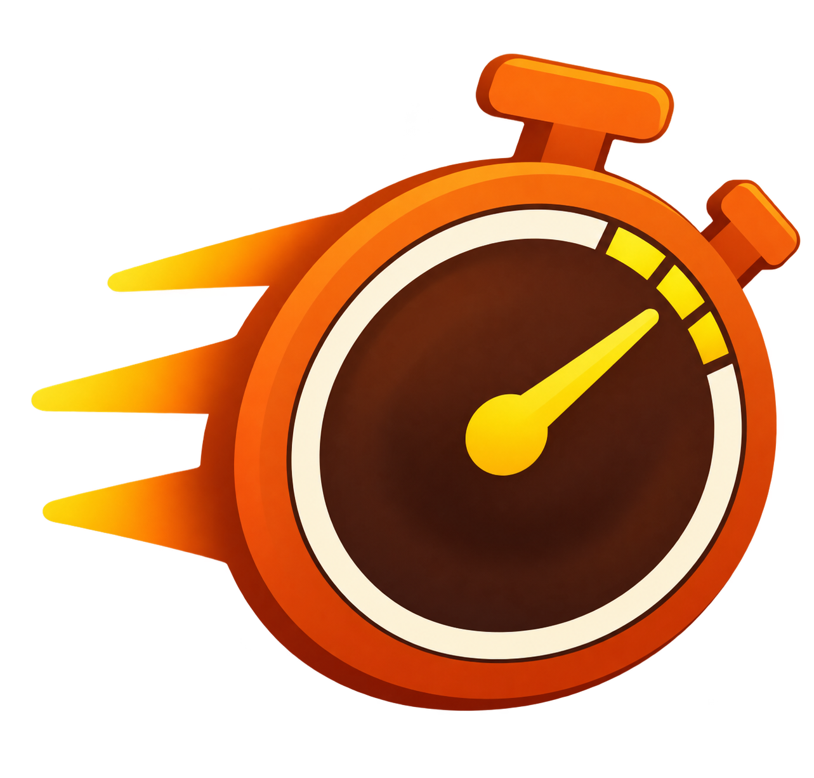
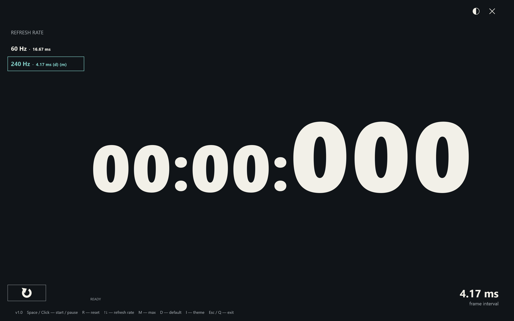

# FPS Stopwatch



Licensed under the [MIT License](LICENSE).

**Windows only — Windows 10/11 x64. Linux and macOS are not supported.**

Developed with the assistance of **OpenAI ChatGPT Codex**.

**A display-synchronized stopwatch for careful FPV video-latency measurements.**

FPS Stopwatch makes the most of your monitor's available refresh rates: it displays large, stable millisecond readings and lets you switch to the highest supported rate at the current resolution. Its timing and rendering are designed for comparing the original screen with the image delivered through an FPV video system.



*Actual application screenshot on a 2560 × 1600 display. Available modes on this monitor are 60 and 240 Hz; other monitors will show their own supported rates.*

## Designed around your display

- **High-resolution timekeeping:** a monotonic Windows performance counter measures elapsed time independently of frame count. Dropped frames do not slow the stopwatch.
- **Display-synchronized output:** VSync and a low-latency presentation queue are used to target one fresh reading per display refresh, without tearing. Time is sampled when preparing each frame.
- **Use the screen's capabilities:** press **M** to select the highest listed refresh rate at the current resolution. The app starts with your current Windows mode and changes it only when you choose a rate.
- **Know the update interval:** every refresh-rate entry shows its nominal frame interval in milliseconds, with the active interval also displayed in the lower-right corner.
- **Readable comparisons:** bold, fixed-width digit cells, larger milliseconds, and two contrasting themes make readings easier to identify in photographs.

The useful limit is the monitor's refresh rate, not how many frames the GPU can render off-screen. For example, 240 Hz offers a nominal update interval of **4.17 ms**, compared with **16.67 ms** at 60 Hz. Higher refresh rates provide finer temporal sampling; they do not guarantee that the complete measurement is accurate to 1 ms.

## Run

Run **`dist/fps-stopwatch.exe`** after building. No installer, administrator rights, Visual C++ Redistributable, or adjacent DLLs are required. The app uses Windows' built-in DirectX and text-rendering components.

## Screen and controls

- Time format: **`mm:ss:uuu`** (milliseconds), with larger millisecond digits.
- **Space**: start / pause / resume. Starts at zero, paused.
- **R** or the circular-arrow button at the bottom left, below the refresh-rate list: reset to zero, keeping the running / paused state. The button is half the width of the list panel.
- **Left-click outside the theme, exit, reset, and refresh-rate controls**: start / pause / resume, just like Space. Clicking a control does not toggle the stopwatch.
- **Up / Down**: apply the previous / next refresh rate in the list.
- **M**: maximum refresh rate at the current resolution.
- **D**: the refresh rate Windows was using when the app started.
- **I** or the half-circle button: toggle light / dark theme.
- **Esc**, **Q**, **Alt+F4**, or the close button: exit.
- Click a refresh-rate row to apply it. Use the mouse wheel to scroll a long list.

The app opens on the primary monitor at its current resolution and refresh rate. The original rate is highlighted and marked `(d)`; the maximum is marked `(m)`. Each row includes its frame interval in milliseconds. The active rate is outlined. Mode changes are temporary; the original configuration is restored on normal exit or a handled error. Forced process termination or an OS crash cannot guarantee restoration. Refresh switching is disabled for duplicated displays.

The theme starts dark on each launch. There is no installer, settings file, or windowed mode.

## Measurement

1. Run the stopwatch on the computer screen and point the FPV camera at it.
2. Select the desired refresh rate, or press **M** for the maximum available at the current resolution.
3. Start the stopwatch using **Space** or a click outside the controls.
4. Photograph the computer screen and receiver screen together, with both readings visible.
5. Subtract the receiver's reading from the computer's reading. Take several photographs to observe variation in latency.

For example, `00:12:483 − 00:12:450 = 33 ms` of observed end-to-end video latency.

**Millisecond readability is not the same as millisecond measurement accuracy.** The displayed frame interval describes the selected display mode; it is not a measured FPS value or an error bound. Camera exposure and rolling shutter, display scanout and response, the receiver's refresh cycle, and frame drops can all affect the result. This method measures the observed camera-to-receiver-screen path, including the receiver display.

## How timing works

Time comes from `QueryPerformanceCounter`, independently of rendered frame count. Direct3D 11 / DXGI flip-model presentation uses VSync, a frame-latency waitable object, and a maximum frame latency of one. The renderer waits before sampling time and preparing each frame. Digits are cached DirectWrite layouts with fixed digit-cell widths and a shared baseline. Rendering pauses in the background; elapsed time continues correctly.

## Build

For setup, build commands, testing, packaging, and troubleshooting, see the [Windows build guide](docs/BUILD.md).

Install [Microsoft C++ Build Tools](https://visualstudio.microsoft.com/visual-cpp-build-tools/) with **Desktop development with C++**, including MSVC x64/x86, Windows SDK, and C++ CMake tools.

From PowerShell in this directory:

```powershell
.\build.ps1
```

This discovers the installed Microsoft tools, configures CMake, builds Release x64, runs the clock tests, and copies the standalone executable to `dist/fps-stopwatch.exe`. MSVC's runtime is linked statically (`/MT`). Only the executable is needed on the destination computer. `build/`, `dist/`, and local compiler downloads in `.tools/` are ignored by Git.

Alternatively, use CMake directly with an installed Visual Studio generator:

```powershell
cmake -S . -B build -A x64
cmake --build build --config Release
ctest --test-dir build -C Release --output-on-failure
```

## Developer checks

```powershell
.\build.ps1 -SmokeTest
.\build.ps1 -SmokeTest -TestRefresh
```

The smoke test briefly opens the fullscreen app, exercises start/pause/resume, ignores repeated Space events, switches themes through keyboard and mouse handlers, captures the app's own back buffer to `build/smoke-dark.png` and `build/smoke-light.png`, then exits through Q. Results are written to `build/smoke-test.txt`. Adding `-TestRefresh` temporarily applies a different supported refresh rate and returns to the original before exit. This can briefly blank the display during the mode change.

Clock tests cover pause/resume, reset, millisecond truncation, long gaps without rendered frames, and minute rollover. The graphics smoke test also checks mouse and keyboard controls, including reset while running and paused. Switching between 240 and 60 Hz and restoring the initial mode have been verified on the development machine. Other hardware and physical FPV measurement accuracy require separate validation.

Hardware validation and limitations are recorded in [docs/VALIDATION.md](docs/VALIDATION.md). Requirements are documented in [docs/SPECIFICATION.md](docs/SPECIFICATION.md).
